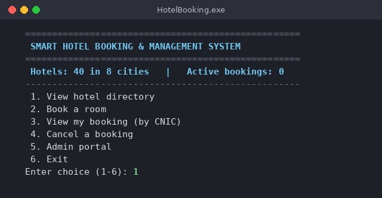
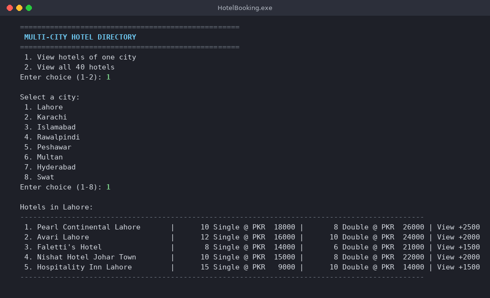
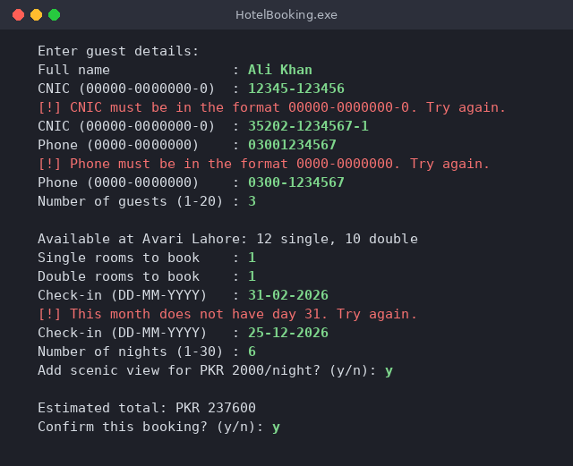
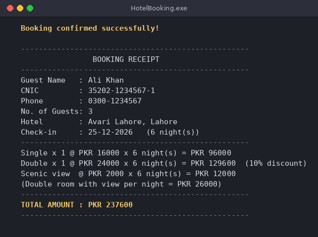
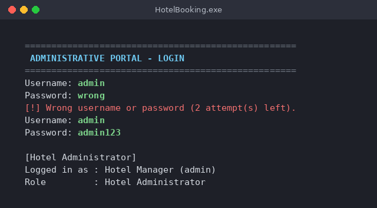
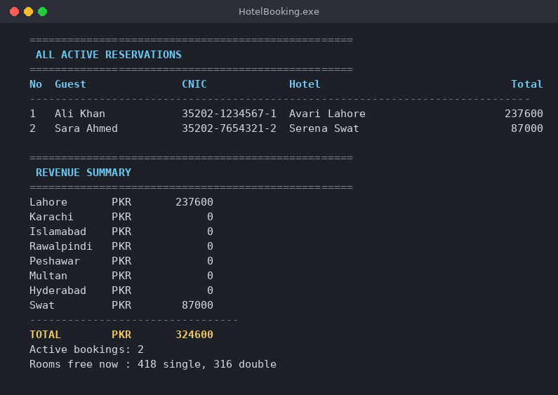
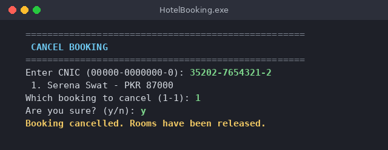

# Smart Hotel Booking & Management System

An object-oriented **C++ application** for booking hotel rooms across 8 cities of Pakistan, with a **console version** and a **Qt desktop GUI** that share the same classes.

The program manages 40 hotels in Lahore, Karachi, Islamabad, Rawalpindi, Peshawar, Multan, Hyderabad and Swat. Guests can book Single and Double rooms, add a scenic view, look up or cancel bookings with their CNIC, and an admin can manage tariffs and view revenue. All data is saved in text files, so bookings are still there the next time the program runs.



---

## Features

- **Multi-city hotel directory**: 40 hotels in 8 cities with live Single and Double room availability.
- **Room reservation**: book several single and double rooms, choose the number of nights, and add an optional scenic view (PKR 1,500 to 3,000 per night).
- **Itemized bill**: room charges, scenic view charges and a 10% discount on Double rooms for stays of 5 nights or more.
- **Input validation**: CNIC (`00000-0000000-0`), phone (`0000-0000000`), dates (`DD-MM-YYYY`, including leap years) and numbers are checked using exceptions.
- **Overbooking protection**: a booking is rejected if there aren't enough rooms or if the rooms can't hold the number of guests.
- **Booking lookup and cancellation by CNIC**: cancelling a booking releases its rooms.
- **Password-protected admin portal**: view all reservations, change room and scenic view prices, and see revenue by city.
- **File storage**: `hotels.txt` and `guest_info.txt` keep all data between runs.
- **Two frontends, one set of classes**: the console app (`main.cpp`) and the Qt window (`gui/`) both use `HotelManager`, so the booking rules, validation and file handling are written only once.

---

## OOP Concepts Used

| OOP Concept | Where it is used |
|---|---|
| Classes, objects, constructors and destructors | `Person`, `Guest`, `Admin`, `Room`, `Hotel`, `Booking` (default, parameterized and copy constructors) |
| Arrays of objects | `Hotel` array (40 hotels) and `Booking` array, owned by `HotelManager` |
| Static members | `Booking::activeBookings` counts the active bookings |
| Const member functions | All getters and `displayDetails()` / `printReceipt()` |
| Operator overloading | `++` / `--` on `Room` to release or book a room, `+` on `Room` (price + scenic charge), `==` on `Guest` (compare CNIC) |
| Inheritance | `Person` → `Guest`, `Admin`; `Room` → `SingleRoom`, `DoubleRoom` |
| Composition | A `Hotel` creates and owns its `Room` objects and deletes them in its destructor |
| Aggregation | A `Booking` points to an existing `Hotel` |
| Polymorphism | Pure virtual functions `calculateCost()`, `displayDetails()`, `getRole()` called through `Room*` and `Person&` |
| Templates | `SearchUtility<T>` searches hotels by city and bookings by CNIC with the same code |
| Exception handling | `InputValidator` throws `invalid_argument`; overbooking throws `runtime_error` |
| File handling | `<fstream>` reads and writes `hotels.txt` and `guest_info.txt` |
| Multi-file program | Separate `.h` and `.cpp` file for every class |

---

## Class Structure

```
Person (abstract)            Room (abstract)
 ├── Guest                    ├── SingleRoom
 └── Admin                    └── DoubleRoom

Hotel  ◆── Room* rooms[2]     (composition)
Booking ──> Hotel*            (aggregation)
Booking ──  Guest             (stores guest details)

HotelManager ◆── Hotel[], Booking[]   (loads/saves files, used by both frontends)
InputValidator                (static validation helpers)
SearchUtility<T>              (template search)

MainWindow : QMainWindow      (Qt GUI only, uses HotelManager)
```

---

## Project Files

```
HotelBookingSystem/
├── Person.h / Person.cpp                  Person, Guest, Admin
├── Room.h / Room.cpp                      Room, SingleRoom, DoubleRoom
├── Hotel.h / Hotel.cpp                    Hotel
├── Booking.h / Booking.cpp                Booking
├── InputValidator.h / InputValidator.cpp  InputValidator
├── SearchUtility.h                        SearchUtility<T> (header-only template)
├── HotelManager.h / HotelManager.cpp      HotelManager (hotels, bookings, files)
├── main.cpp                               Console menus
├── gui/                                   Qt desktop version
│   ├── main.cpp
│   ├── MainWindow.h / MainWindow.cpp      The window and its 5 pages
│   ├── CMakeLists.txt                     Build with CMake (Qt 5 or Qt 6)
│   └── HotelBookingGUI.pro                Or open this in Qt Creator
└── screenshots/
```

`hotels.txt` and `guest_info.txt` are created automatically when the program runs.

---

## How to Compile and Run

### Console version

You need a C++17 compiler (GCC / MinGW, or Visual Studio).

```bash
g++ -std=c++17 *.cpp -o HotelBooking
```

Run it:

```bash
./HotelBooking        # Linux / macOS
HotelBooking.exe      # Windows
```

### Qt GUI version

1. Install **Qt** with **Qt Creator** (free, from qt.io). Qt 6 or Qt 5 both work.
2. In Qt Creator, choose **File > Open File or Project** and open `gui/CMakeLists.txt` (or `gui/HotelBookingGUI.pro`).
3. Pick a kit (for example *Desktop Qt 6 MinGW 64-bit*) and press **Run**.

Or from a terminal:

```bash
cd gui
cmake -B build
cmake --build build
```

The GUI has five pages in the sidebar: **Hotel directory**, **Book a room** (live price estimate and capacity check), **My booking**, **Cancel booking** and **Admin portal** (reservations, revenue by city and room tariffs).

**Admin login (both versions):** username `admin`, password `admin123`

---

## Screenshots (console version)

### Hotel directory


### Booking with input validation


### Booking receipt


### Admin login


### Admin reports


### Cancel a booking


---

## Notes

- Hotel names are real, but the room prices and availability are sample data for this project.
- Availability is counted per hotel, not per date. The check-in date and number of nights are saved with the booking and used for the bill.
